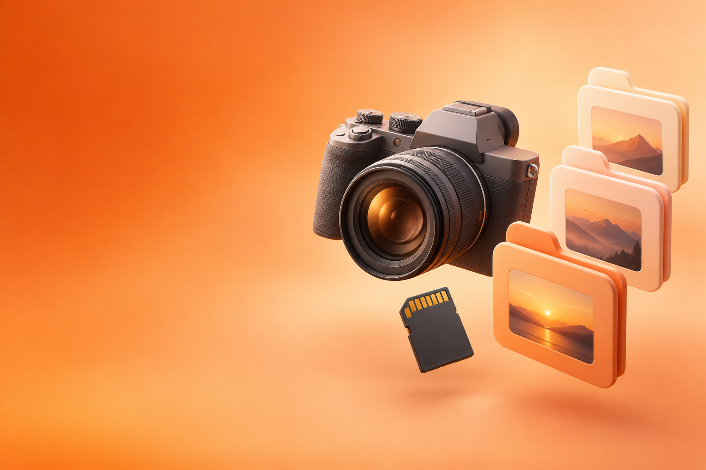
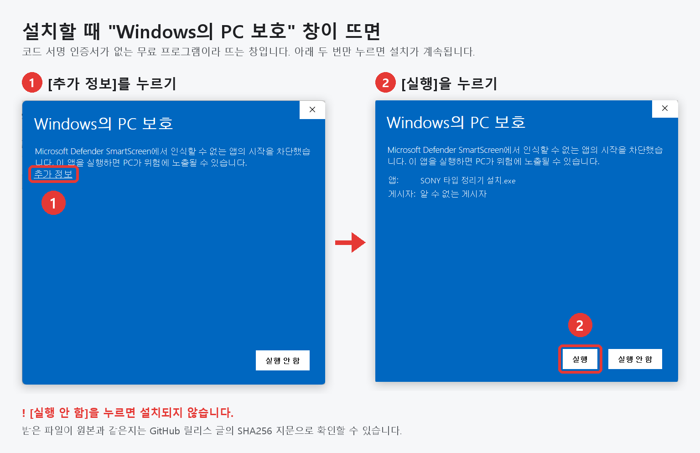

# SONY 타입 정리기 (베타)



소니 카메라로 찍은 영상·프록시·사진을 **촬영일별 폴더**로 정리하는 Windows 프로그램입니다.
카드를 PC로 복사한 폴더를 창에 끌어다 놓고 [정리 시작]만 누르면 됩니다.

> [!NOTE]
> **Sony(소니)가 만든 정식 프로그램이 아닙니다.** 개인(이중필름)이 만든 비공식 무료 프로그램이며 Sony와는 관련이 없습니다.
> 'SONY 타입'은 소니 카메라가 만드는 카드 구조(파일)를 정리한다는 뜻입니다. 1.4까지의 이름은 **소니정리툴**입니다.

> 1.5 베타 · 만든 사람: 이중필름 (유튜브 채널 **[이중필름](https://www.youtube.com/@2J_FILM)**) · 문의: nasunfilm@gmail.com · 비영리 무료 배포

> [!WARNING]
> **반드시 원본을 복사한 뒤, 복사한 폴더를 정리하세요.**
> 이 프로그램은 PC로 복사해 둔 데이터를 정리하도록 만들었으며, SD카드나 유일한 원본을 바로 정리하는 방식은 고려하지 않았습니다.
> 테스트를 거쳐 안전하다고 판단해 배포하지만, PC 환경(백신·동기화 프로그램·저장 장치 등)에 따라 예상하지 못한 문제가 생길 수 있습니다.
> 원본 카드나 백업본은 정리가 끝나고 결과를 확인할 때까지 지우거나 포맷하지 마세요.

## 내려받기 · 설치

[Releases](https://github.com/musiqsb-svg/sony-sort-tool/releases)에서 **`SonySortTool-1.5.zip` 하나만** 받으면 됩니다. 압축을 풀면 세 파일뿐입니다.

| 파일 | 하는 일 |
|---|---|
| **SONY 타입 정리기 설치.exe** | 실행하고 [설치하기] 한 번. 이전 버전이 있으면 그대로 업데이트 (설정·기록 유지) |
| **SONY 타입 정리기 제거.exe** | 실행하고 [제거하기] 한 번. [설정 › 앱]에서 제거하는 것과 같음 |
| 사용 안내.txt | 설치·사용·제거 안내 |

- Windows 10/11. 관리자 권한 없이 지금 사용자 계정에만 설치됩니다 (`%LOCALAPPDATA%\Programs\SonySortTool`).
- 설치하면: 시작 메뉴, 바탕화면 아이콘(선택), 폴더 우클릭 **SONY 타입 정리기로 정리**(선택), [설정 › 앱]의 제거 항목
- 제거하면: 위 항목과 설정·옮긴 기록(`%LOCALAPPDATA%\SonySortTool`)을 지웁니다. **정리한 영상·사진 폴더는 그대로**입니다.
- 1.4까지의 소니정리툴(Inno Setup으로 설치한 버전) 위에도 그대로 설치됩니다. 먼저 지울 필요가 없습니다.

> [!IMPORTANT]
> **설치 파일을 열 때 파란 "Windows의 PC 보호" 창이 뜨면 → ① [추가 정보] → ② [실행]**
>
> 코드 서명 인증서(유료)가 없는 무료 프로그램이라 Windows가 띄우는 창입니다. 처음 보이는 화면에는 [실행 안 함]만 있으니,
> 그 위의 **[추가 정보]** 글자를 누르면 나타나는 **[실행]** 버튼을 누르세요. [실행 안 함]을 누르면 설치되지 않습니다.
> 받은 파일이 원본과 같은지는 릴리스 글의 SHA256 지문으로 확인할 수 있습니다.



## 사용법

1. SD카드 내용을 PC 폴더로 **복사**합니다. 원본은 그대로 둡니다.
2. SONY 타입 정리기를 열고 그 폴더를 창에 끌어다 놓습니다. (또는 [폴더 선택…])
   폴더를 우클릭해 **SONY 타입 정리기로 정리**를 눌러도 됩니다. (Windows 11은 '더 많은 옵션 표시' 안에 있음)
3. 미리보기를 확인하고 [정리 시작]을 누릅니다. 마음에 들지 않으면 [되돌리기].

## 정리 결과

```
넣은 폴더
└ 261004_DATA_29.5G                 ← 폴더 이름 끝에 용량 (옵션, 기본으로 켜짐)
   ├ 261004_Footage    원본 영상     C0561.MP4
   ├ 261004_Proxy      프록시        C0561_Proxy.MP4        ← M4ROOT\SUB\C0561S03.MP4
   ├ 261004_XML        메타데이터    C0561M01.XML           ← 'XML 지우기'를 끈 경우만
   └ 261004_Photo
      ├ jpg
      ├ arw
      └ hif
```

## 소니 카드에 맞춘 규칙

| 소니 카드의 특징 | 정리 방법 |
|---|---|
| 영상 파일명(C0001)에 날짜가 없음 | 짝인 XML(`C0001M01.XML`)의 촬영 시작 시각으로 날짜를 정함 (카메라 시간대 그대로). XML이 없으면 수정한 날짜 |
| 프록시는 `SUB\원본이름S03.MP4` | 원본과 같은 날, 이름은 `원본이름_Proxy.MP4` (Premiere에서 바로 프록시로 연결) |
| S&Q(슬로·퀵모션)는 프록시가 안 생김 | XML로 알아보고 "프록시 없는 원본: C0598(S&Q)"로 알림 |
| 파일 번호가 카드마다 C0001부터 다시 시작 | 같은 이름이 이미 있으면 덮어쓰지 않고 건너뛰고 미리 알림 → 카드마다 다른 폴더에 정리 권장 |
| 기종에 따라 `M4ROOT` 또는 `PRIVATE\M4ROOT` | 둘 다 찾음 |
| `M4ROOT\THMBNL`의 JPG는 영상 썸네일 | 사진으로 섞지 않음 |
| 파일 이름 앞부분을 바꾼 카메라 (예: `A7V_0001`) | XML·프록시 짝을 이름으로 맞춤 |

- 넣을 수 있는 폴더: 카드를 통째로 복사한 폴더, `M4ROOT` 폴더, 영상과 XML만 모은 폴더
- 파일만 모은 폴더에서는 짝인 XML이 있는 MP4, 소니 이름(`DSC…`) 사진, ARW만 소니 파일로 봅니다. 다른 파일은 그대로 둡니다
- 옛 AVCHD(`.MTS`)·업무용 XDCAM(`.MXF`) 영상은 정리하지 않고 알려 줍니다

## 옵션 (설정은 기억됨)

| 옵션 | 기본 | 내용 |
|---|---|---|
| XML은 휴지통으로 | 켜짐 | 끄면 날짜별 `XML` 폴더에 따로 모음 (영상과 섞지 않음). 원본을 못 옮긴 클립의 XML은 그대로 둠 |
| 날짜 폴더 이름에 용량 | 켜짐 | `261004_DATA_29.5G` (1024 기준, 소수점 한 자리 내림). 같은 날짜를 나중에 추가로 정리하면 합치고 갱신 |
| 남은 카드 관리 파일도 휴지통으로 | 켜짐 | M4ROOT(썸네일 등)·PRIVATE·AVF_INFO·SONY. 영상·사진 등 다른 파일이 남아 있으면 보내지 않고, 결과에 그 파일을 알려 줌 |

- 파일이 하나도 없는 카드 폴더(사진을 안 찍은 카드의 빈 `DCIM\100MSDCF` 등)는 옵션과 상관없이 지웁니다
- 탐색기·Mac·NAS가 만드는 찌꺼기(`Thumbs.db`, `desktop.ini`, `.DS_Store`, `._파일이름`, `@eaDir`)는 정리 대상으로 세지 않고,
  이것만 남은 폴더는 찌꺼기와 함께 지웁니다 (이것 때문에 `DCIM` 등이 남지 않게)

> 용량 표기가 켜져 있으면 폴더 이름이 바뀝니다. Premiere로 가져오기 전에 정리하세요.

## 안전장치

- 파일을 넣은 폴더 안에서 **옮기기만** 합니다 → [되돌리기]로 원래대로 (휴지통으로 보낸 XML·카드 파일은 휴지통에서 직접 복원)
- 같은 이름이 있으면 덮어쓰지 않습니다
- 정리가 끝나면 옮긴 파일이 모두 제자리에 같은 크기로 있는지 확인해 알려 줍니다
- SD카드에서 바로 정리하지 않습니다 (PC로 복사한 뒤 사용)
- 인터넷 연결·정보 수집 없음. 설정과 옮긴 기록만 `%LOCALAPPDATA%\SonySortTool`에 저장
- 예상하지 못한 오류가 나면 내용을 같은 곳의 `logs\error_….txt`에 남깁니다 (문의할 때 첨부)

## 1.5에서 바뀐 점

- **이름을 'SONY 타입 정리기'로 바꿈** (예전 이름: 소니정리툴). Sony가 만든 정식 프로그램이 아니라는 점을 분명히 하려고,
  화면·설치 프로그램에도 "Sony 정식 프로그램이 아닙니다"를 표시합니다. 소니정리툴 설치본 위에 그대로 업데이트되고, 옛 이름의 바로가기는 새 이름으로 바뀝니다
- **배포를 zip 하나로**: 압축을 풀면 '설치'·'제거'·'사용 안내' 세 파일뿐입니다. 소스 코드·Portable·지문 파일은 zip에서 뺐습니다 (소스는 이 저장소, 지문은 릴리스 글)
- **원클릭 설치·제거**: Inno Setup 대신 직접 만든 설치 프로그램. [설치하기] 한 번으로 설치·업데이트, [제거하기] 한 번으로 제거. 1.4 설치본도 그대로 이어받음
- **화면 새 디자인**: 끌어다 놓는 곳 그림, 폴더를 넣으면 작아져 표가 넓어지는 구역, 날짜별 표, 켜고 끄는 스위치, 결과 요약 카드
- 작은 화면(노트북 150% 배율 등)에서도 창이 화면을 넘지 않게
- 예상하지 못한 오류 내용을 기록 폴더에 저장

## 빌드·테스트

Windows 10/11에 기본으로 들어 있는 C# 컴파일러(.NET Framework 4.x)만 씁니다. 설치 프로그램도 직접 만들므로 따로 설치할 것이 없습니다.

```
powershell -ExecutionPolicy Bypass -File build.ps1 -Test
```

- `dist\SonySortTool.exe` — 프로그램 (설치 없이도 바로 실행됨)
- `dist\Setup.exe` · `dist\Uninstall.exe` — 설치·제거 프로그램 (배포 이름: `SONY 타입 정리기 설치.exe` · `SONY 타입 정리기 제거.exe`)
- `build\OrganizerTest.exe` — 정리 로직 테스트. 실제 카드(ILCE-7M5) 구조를 본뜬 가짜 카드로 여러 상황을 확인
  - `OrganizerTest.exe --replica <폴더>` — 실제 카드 폴더를 XML은 내용까지, 나머지는 1바이트로 복제해 시험 (원본은 건드리지 않음)
- `tests\SetupTest.ps1` — 설치·제거 테스트. 새로 설치·다시 설치·1.4 이전 설치본 업데이트·실행 중 막기·제거를
  임시 폴더와 별도 레지스트리 키(`/sandbox`)에서만 해 보므로 이 PC에 설치된 SONY 타입 정리기(옛 소니정리툴)는 건드리지 않음

배포 파일까지 만들려면 `-Release`를 붙입니다 (버전은 `src\Product.cs`의 `Version`과 `src\app.manifest` 두 곳).

```
powershell -ExecutionPolicy Bypass -File build.ps1 -Release
```

```
release\
├ SonySortTool-1.5.zip      ← 이것 하나만 배포 (GitHub 릴리스에 그대로 올림)
│   ├ SONY 타입 정리기 설치.exe
│   ├ SONY 타입 정리기 제거.exe
│   └ 사용 안내.txt
└ SHA256.txt                ← 릴리스 글에 붙일 파일 지문
```

| 파일 | 내용 |
|---|---|
| `src\Organizer.cs` | 소니 카드 정리 로직 (미리보기·정리·되돌리기) |
| `src\MainForm.cs` | 화면 |
| `src\Ui.cs` | 화면 공통 부품 (둥근 버튼·토글·진행 막대·카드·머리 그림). 설치·제거 프로그램도 함께 씀 |
| `src\Product.cs` | 이름·버전·색 등 제품 정보 (한 곳에서 관리) |
| `src\FolderPicker.cs` | 탐색기 모양 폴더 선택 창 |
| `src\Settings.cs` | 설정 저장 |
| `setup\Setup.cs` | 설치·제거 프로그램 (같은 소스로 두 파일을 만듦) |
| `setup\guide.txt` | 배포 zip의 `사용 안내.txt` |
| `assets\make_icon.ps1` | 아이콘 (프로그램 · 설치 ↓ · 제거 ×) |
| `assets\art\` | Codex 이미지 생성으로 만든 그림 (설치 화면 · 끌어다 놓는 곳). 프롬프트는 `assets\art\prompts.md` |
| `assets\guide\` | README 안내 그림 ("Windows의 PC 보호" 창 대응) |

## 문의

- 만든 사람: 이중필름 (유튜브 채널 **[이중필름](https://www.youtube.com/@2J_FILM)**)
- 문의·오류 제보: nasunfilm@gmail.com — 정리하려던 폴더 구조와 결과 화면을 함께 보내 주시면 빨리 확인할 수 있습니다.

## 라이선스

MIT 라이선스 — 자유롭게 쓰고 고치고 나눌 수 있습니다. 자세한 내용은 [LICENSE](LICENSE)를 보세요.
© 2026 이중필름
